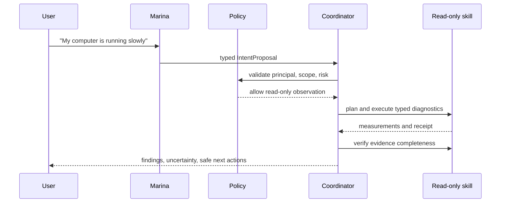

# MarinaOS capability and contract catalog

Model output is an untrusted proposal. A capability is a typed boundary with
an authenticated requester, explicit scope, policy decision, operation ID,
verification, and evidence receipt.

| Capability family | Read examples | Mutation examples | Initial authority | Verification |
| --- | --- | --- | --- | --- |
| Files | stat, list, disk usage | move, delete, permissions | user scope; sensitive changes approved | re-read metadata/content hash |
| Processes/services | process table, service status | stop/restart service | user or system policy | observed state and exit/status |
| Packages | installed/version/update availability | install/remove/update | privileged approval | package database and service health |
| Storage | mounts, capacity, SMART where available | cleanup/mount/format | destructive approval | mount/usage/device checks |
| Network | links, routes, connectivity | firewall/routes/services | privileged/security approval | route/rule/connectivity checks |
| Devices | inventory and health | configure/enable | privileged policy | device state and telemetry |
| Diagnostics | CPU, memory, load, I/O, logs | none by default | user-scoped observation | timestamped source measurements |
| Backup/recovery | backup status and snapshots | create/restore | explicit scope and approval | restore/list/hash checks |

The initial “slow computer” path uses only read operations. It must not turn a
diagnostic explanation into a mutation or claim improvement without a second
measurement.

## Interaction sequence

