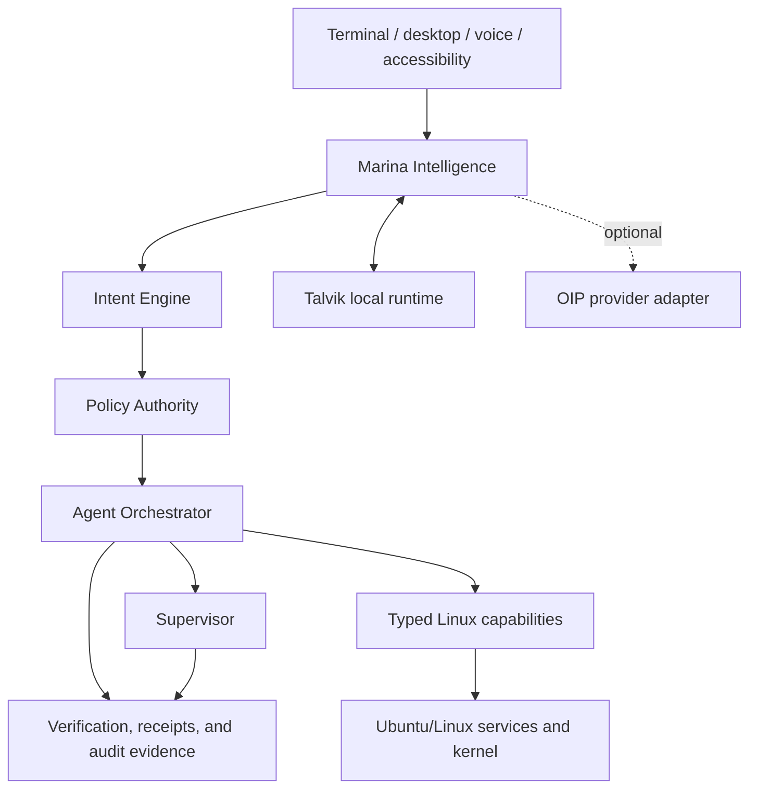

# MarinaOS product architecture

Status: Proposed consolidation plan (2026-11-04)

MarinaOS is the proposed public umbrella for a Linux-based operating system
that translates user intent into authorized, supervised, verifiable system
operations. This repository remains the source of truth for the current OID
control plane and Talvik runtime until the naming decision is accepted.

## Ownership

The MarinaOS control plane owns intent interpretation, typed planning,
authorization, approvals, orchestration, verification, recovery, context
policy, and user-visible explanation. Linux remains the authority for process
isolation, users, filesystems, package management, and kernel security.

Talvik remains a separately installable cross-platform inference runtime. It
owns model artifacts, inference, scheduling, admission, streaming,
cancellation, and runtime telemetry. It never receives operating-system
authority from a prompt or model output. OIP is an optional intelligence
provider; Delivery OS is a separate delivery platform that may request
authorized execution environments.

## First proof

The first end-to-end proof is the diagnostic intent “my computer is running
slowly”. Marina accepts and validates a typed read-only proposal, collects
actual health/process/filesystem evidence through existing skills, explains
findings, and only later offers an explicitly authorized mutation. It must
work when OIP is disconnected and must identify CPU fallback truthfully.

This is not a distribution release claim. Package installation on supported
Ubuntu is Milestone 1; reproducible images, boot, installation/recovery, and
hardware qualification follow the gates in the migration plan.
