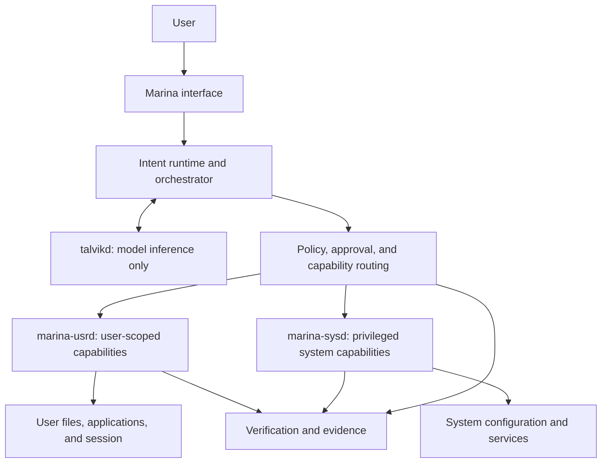

# ADR-0027: MarinaOS Product and Execution Architecture Proposal

- Status: Proposed
- Date: 2026-10-27
- Related: ADR-0004, ADR-0005, ADR-0006, ADR-0014, ADR-0016, ADR-0019,
  ADR-0023; WP-0068, WP-0069, WP-0072, WP-0088, WP-0104

## Context

The repository has grown beyond its original intent-driven console scope. It
contains a Linux-first desktop/OS control plane, a cross-platform model
runtime, governed operation and evidence foundations, Linux skills, packaging,
and an image-build track. The name `intent-driven-os` describes an architectural
principle more than the product family.

The current accepted product-brand decision in ADR-0019 distinguishes OID as
the Linux AI desktop/OS and Talvik as the standalone model runtime. It does not
define a product-wide MarinaOS umbrella or separate user- and system-privilege
execution services. This proposal records those candidate directions for
review; it does not supersede accepted ADRs.

The intended safety boundary remains that a model can interpret and propose,
but cannot directly execute operating-system actions. Any change to ownership
of planning, policy, approvals, execution, verification, rollback, or evidence
requires an explicit decision and must preserve the operation lifecycle in
ADR-0005 and ADR-0006.

## Proposal

### Product naming direction

Consider **MarinaOS** as the umbrella product and repository identity for the
integrated Linux AI operating environment. Under that possible family:

| Candidate component | Proposed responsibility | Candidate delivery |
| --- | --- | --- |
| `marina` | User-facing conversational/terminal interface | Linux-first |
| `marina-runtime` | Intent interpretation and orchestration integration | Linux-first |
| `talvikd` | Model lifecycle, inference, streaming, cancellation, and health | Linux, macOS, Windows |
| `marina-usrd` | Bounded operations in a logged-in user's context | Linux-first |
| `marina-sysd` | Narrow, privileged system operations | Linux-first |
| `packages/` | Distro package definitions and service integration | Linux |
| `image/` | Reproducible installation/image composition | Linux |

This layout is conceptual, not a required workspace or filesystem structure.
The existing Rust crates and binaries remain authoritative until a separate
migration plan is approved. In particular, `oid-console` and
`oid-marina-chat` are not renamed by this proposal.

### Candidate execution architecture

The proposed product story is:

> **Talvik thinks. Marina governs and orchestrates. `sysd` and `usrd` execute
> bounded capabilities.**

In this candidate design:

- `talvikd` remains a model service. It does not receive OS execution authority,
  credentials for privileged actions, or direct access to executor APIs.
- The orchestrator translates requests into typed capability requests; it does
  not treat model output as an executable command.
- `marina-usrd` owns only explicitly granted user/session capabilities.
- `marina-sysd` is a separately installed, separately identified privileged
  service with a narrow allowlisted API. It does not accept arbitrary shell
  commands or model-authored scripts.
- Policy and approval decisions are enforced at the execution boundary, not
  delegated to the model.
- Every mutating operation retains plan, authorization, approval where
  required, execution, verification, rollback outcome, and evidence identity.
- A request is routed to the least-privileged executor that can satisfy its
  declared capability. If no executor can safely satisfy it, it is rejected.

Illustrative capability families include per-user file and desktop/session
operations for `marina-usrd`, and network configuration, package management,
system services, mounts, devices, and power operations for `marina-sysd`.
These examples do not grant any capability or establish its approval policy.
Each capability requires its own threat analysis, typed contract, and
verification/rollback behavior.

## Decisions still required

This proposal is not an approval to:

- Rename the GitHub repository to `marina-os`.
- Replace OID as the product name or transfer governance ownership from OID to
  a Marina-branded component.
- Rename crates, Rust packages, binaries, install paths, APIs, environment
  variables, or persistent data.
- Create either executor daemon or grant it privileges.
- Select IPC, authentication, authorization, service-account, or packaging
  details for executor communication.
- Treat the conceptual component tree as the repository's immediate layout.

Before implementation, the project must decide whether MarinaOS is the public
umbrella, whether OID remains the name of the Linux desktop/control plane, and
which component owns the authoritative policy and operation coordinator.
These decisions must be reconciled with ADR-0019 and ADR-0023.

## Consequences if accepted

The product family could present a coherent Linux operating environment while
keeping the cross-platform model runtime independently useful. Separate user
and system executors could make privilege boundaries visible and independently
hardenable.

The architecture would also introduce additional service identities, APIs,
authorization paths, readiness dependencies, upgrade/rollback coordination,
and evidence correlation. A privileged daemon would increase the security
impact of implementation errors. It must not be introduced as a thin wrapper
around unrestricted shell or root access.

## Next design work

WP-0104 is proposed to define the backend-neutral capability contract and
trust boundaries before any executor implementation. It must compare the
existing OID-owned operation coordinator with the candidate Marina-branded
orchestration layer and resolve ownership without weakening approval,
verification, rollback, or evidence.

## Current status

Only the existing OID operation lifecycle, Linux skill contracts, Talvik
runtime, and packaging/image foundations are implemented to their separately
documented scope. The MarinaOS umbrella name and the `marina-sysd` /
`marina-usrd` split are proposals, not implemented services or accepted
product decisions.
