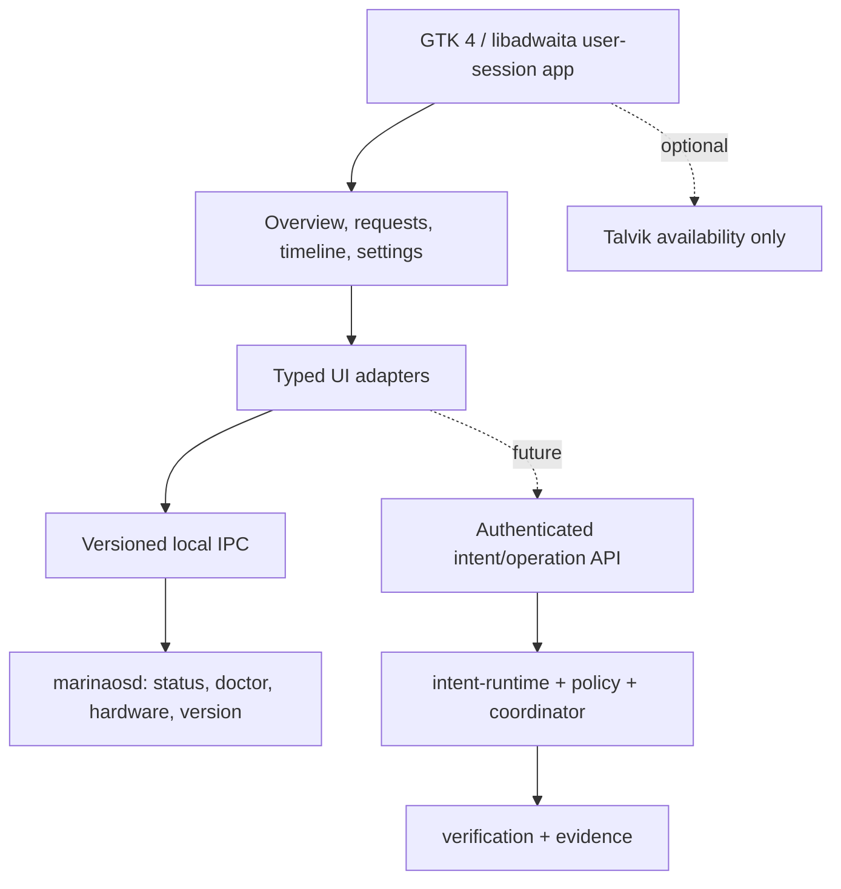

# MarinaOS desktop components

Blocking IPC is isolated to a worker thread and results are delivered through
a nonblocking main-loop poll. No UI component owns privileged handles or native
model state.
