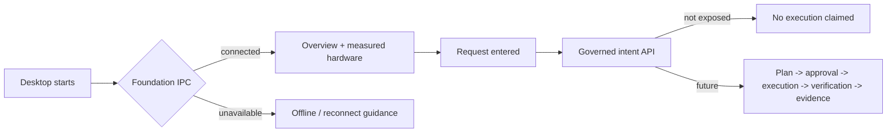

# MarinaOS desktop screen and state specification

The current UI distinguishes connected foundation data, unavailable foundation,
optional Talvik, request-not-submitted, and IPC-receipt timeline states. Future
governed states (`pending`, `planned`, `awaiting approval`, `approved`,
`executing`, `verifying`, `verified`, `rejected`, `failed`) must be driven by
backend events.
